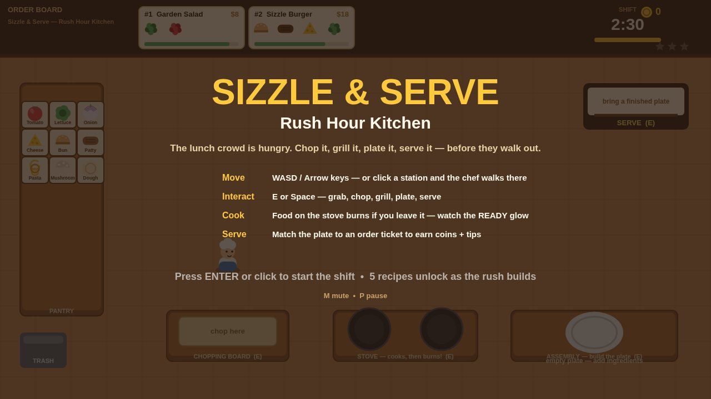
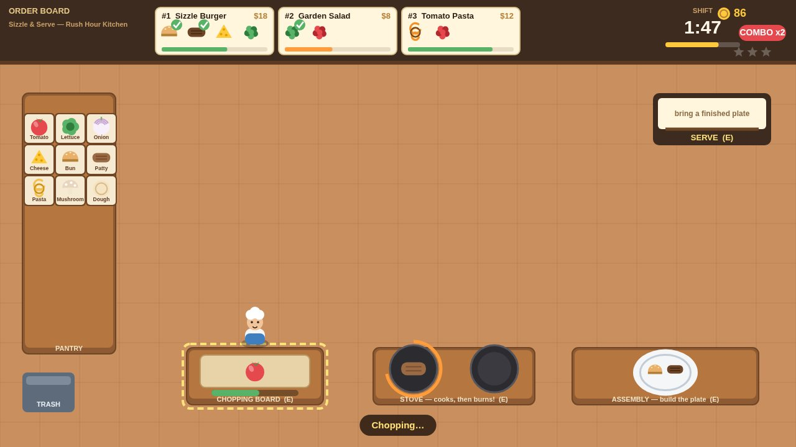
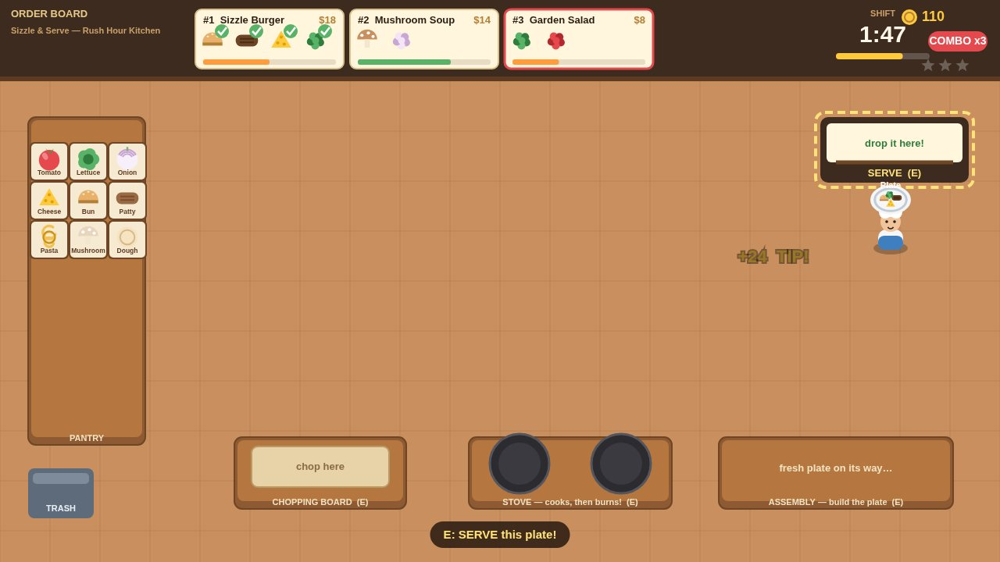
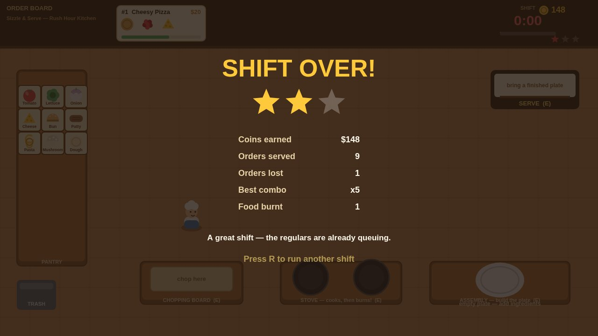

# Sizzle & Serve — Rush Hour Kitchen

[](https://make.fun/bounty/best-cooking-game-20261125-0137?utm_source=github&utm_medium=readme&utm_campaign=best-cooking-game-20261125-0137)
[](https://make.fun/bounty/best-cooking-game-20261125-0137/leaderboard?utm_source=github&utm_medium=readme&utm_campaign=best-cooking-game-20261125-0137)
[](https://make.fun/bounty/best-cooking-game-20261125-0137?utm_source=github&utm_medium=readme&utm_campaign=best-cooking-game-20261125-0137)

A complete, original cooking game that plays offline in a desktop browser from its own static files. Entry for the [make.fun bounty "Make the best cooking game"](https://make.fun/bounty/best-cooking-game-20261125-0137) — $250 across the top 10.

## The game

The lunch crowd is hungry and the clock is running. You are the chef of a tiny kitchen with one pantry, one chopping board, a two-burner stove, an assembly counter and a serving window — and a board full of orders that will not wait.

**How a dish gets made:** grab an ingredient from the pantry → chop it on the board (or grill it on the stove — leave it and it burns) → build the plate at the assembly counter → serve it at the window before the ticket's patience runs out.

**Five recipes** unlock as the shift heats up: Garden Salad, Sizzle Burger, Tomato Pasta, Mushroom Soup and Cheesy Pizza. Each order pays coins plus a tip for fast service, and serving in a row builds a combo multiplier up to x2. The last 30 seconds are rush hour: orders arrive faster and patience drains 1.5x. Three walk-outs end the shift early. The shift ends with a star rating (1–3 stars by coins earned) and a full tally of orders served, lost, best combo and food burnt.

**Controls:** WASD / arrow keys to move, E or Space to interact — or just click a station and the chef walks there. P pauses, M mutes, R runs another shift.

**Feel:** every sound is synthesized live with WebAudio (chops, sizzles, serve chimes, a quiet music loop) — no audio files, no network requests. All art is original vector food and kitchen drawn in canvas.

## Play it

```sh
node serve.ts
# open http://localhost:8080
```

Or serve `game/` with any static HTTP server and open `game/index.html`. No build step, no dependencies, no network.

## Layout

- `main.ts` — the hand-in program: copies `game/` and `screenshots/` to `/output` and writes `dossier.json`
- `game/index.html` — the page; `game/src/` is the game, one file per job:
  - `config.js` — ingredients, recipes, timers, tuning
  - `kitchen.js` — stations, orders, plate, stove and chopping state
  - `input.js` — keyboard + mouse
  - `draw.js` — all canvas rendering: kitchen, food art, chef, HUD
  - `audio.js` — synthesized sounds and music
  - `main.js` — game loop and the rules of play
  - `shots.js` — deterministic screenshot staging (`?shot=start|play|serve|end`)
  - `random.js` — seeded RNG
- `screenshots/` — real renders of the game's own code, taken in headless Chromium
- `vendor/makefun-game.ts` — the make.fun dossier library, copied from the kit unchanged

## Screenshots






## License

MIT — see [LICENSE](LICENSE).
